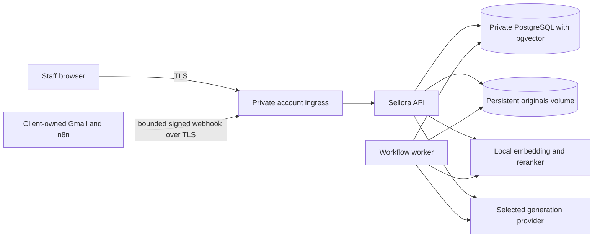

# Pilot deployment design — 14A preparation

**Status:** operator-owned account is the working model. On 2026-10-18, the user
left hosting provider and region undecided and raised client-owned hosting as
an alternative. The first client's location, data terms, resource size and
billing limits remain unknown. This is a reviewable design, not an authorized
deployment or a validated production configuration. Use synthetic data until
those choices and Part 14C restore checks are complete.

## Ownership and topology

The operator owns the deployment account, DNS/TLS, network rules, database,
original-file storage, secrets and monitoring. The client owns its Gmail/n8n
account and OAuth grant. Use one organization per client in Sellora, but do not
assume that application tenant isolation alone satisfies a buyer's isolation
policy. If the buyer requires direct account or region control, put that pilot
in a client-owned account with a separate deployment and contract.

Run one API process and one workflow worker initially; both need the same release
version, private DB access and persistent originals path. Keep PostgreSQL and
original storage private. Expose only HTTPS ingress for staff and the bounded
webhook. The local model endpoint must be private and reachable by API/worker.
No client data or provider keys belong in container images, logs, Git or the
browser. Choose CPU/RAM/storage from measured pilot documents and concurrency;
the 1,000,000-character case is not a supported capacity claim. Mount originals
at the configured `DOCUMENT_STORAGE_DIR` with write access for both processes.
Local development Compose is not a production deployment definition.

## Region and data movement

Choose the region after the first pilot client's location, users, retention
terms and any residency restriction are known. Provider services, pgvector,
private networking and backup location must be available in that region. AWS
notes that region choice affects service availability and latency as well as
legal needs: [AWS Regions](https://docs.aws.amazon.com/global-infrastructure/latest/regions/aws-regions.html).
The operator-owned account choice does not grant consent to move a client's
data between regions.
The operator is in India and expects foreign clients. Choose a region near the
actual client's staff and within agreed residency terms; India alone does not
determine the deployment region. Compare operator-owned and client-owned
hosting in the pilot agreement, including who handles infrastructure incidents,
backups and monthly support. Account ownership does not by itself set the
managed-service fee.

Originals, extracted passages, draft text, citations, email intake metadata and
usage records reside in the selected DB/storage region. Generation/extraction
may transmit prompts, source passages and buyer content to the configured
OpenAI or Groq service; the actual provider/model and its processing location
need client approval. Local Nomic embeddings stay on the configured local model
service, but initial model/reranker downloads contact their distribution hosts.
Gmail/n8n processing follows the separately agreed connector boundary. Record
all of these in the client data-flow agreement before live use.

## Release and recovery order

1. Confirm account owner, provider, region, DNS, budget, client agreement,
   provider/model target and usage limits. Reserve capacity and persistent DB,
   originals and backup locations in the selected region.
2. Provision private network paths, TLS certificate, runtime identities and
   secret references for `DATABASE_URL`, JWT secrets, provider credentials and
   the connector key. Give the worker only its required network/storage access.
3. Restore a copy into a separate environment and pass Part 14C DB/original
   consistency and rollback checks. Back up the live database and originals
   together before a release. Never use `prisma db push` on a client database.
4. Stop intake/worker claims, check migration compatibility and deploy the
   forward migrations once from a dedicated release task. Do not run migrations
   concurrently with multiple API or worker instances.
5. Deploy matching API and worker versions. Check `/health`, `/ready`,
   `/health/worker`, a scoped staff login, a synthetic sourced draft and the
   [operations view](OPERATIONS.md). Re-enable intake only after checks pass.
6. For a failed release, stop intake, preserve data and logs, restore the prior
   application version only if it supports the migrated schema. Otherwise use
   the tested forward recovery or isolated restore procedure from 14C. Do not
   reverse or edit an applied migration in place.

**Open 14A decisions:** account ownership for the first client, named provider/account, exact region, storage/DB product,
resource and monthly budget limits, secret store, DNS/TLS endpoint, backup/restore
target, provider data terms and client retention/erasure agreement. No target
specific configuration or credentials have been created.
